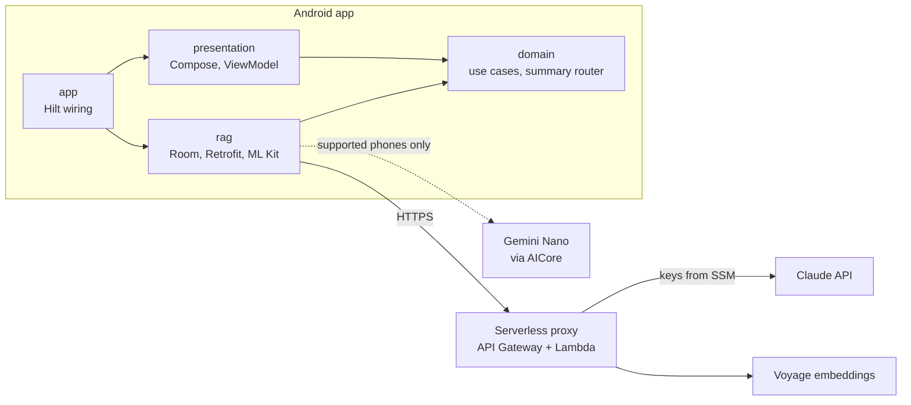
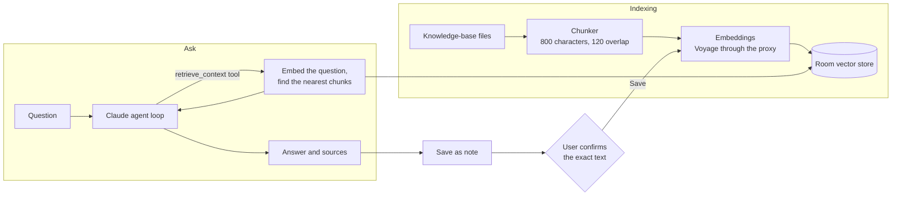
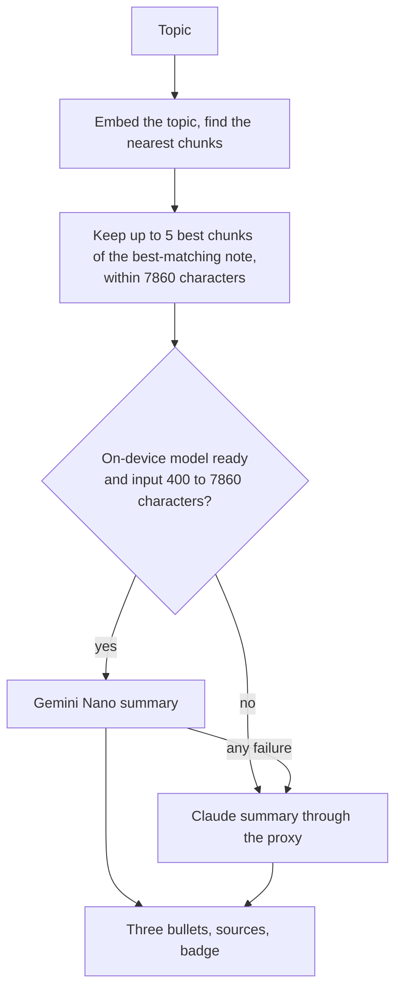

# mobile-rag-agent

An Android app that answers questions and summarizes topics from a personal knowledge base. It combines
a Claude agent (tool use) with a Retrieval-Augmented Generation pipeline, calls the cloud models through a
small serverless proxy so no API keys ship in the APK, and summarizes on the device with Gemini Nano when
the phone supports it. Built on Clean Architecture.

## What it does

- **Ask**: a question about your notes. Claude decides when to search the knowledge base (a
  `retrieve_context` tool) and answers with the sources it used.
- **Save as note**: the model proposes a short fact from the exchange, you see the exact text in a dialog,
  and it is stored only after you confirm.
- **Summarize**: a topic in, three bullet points out. The summary is generated on the device by Gemini
  Nano (ML Kit GenAI Summarization) when available, and by Claude otherwise. A badge shows which one ran
  and, for a cloud summary, why the on-device model was not used.

## Architecture



| Module | Role |
|---|---|
| `domain` | Pure Kotlin, no Android dependency. Models, use-case interfaces and the pure logic that needs no framework (the summary router, bullet parsing, fallback reasons). Unit-testable on the plain JVM. |
| `rag` | The single infrastructure module, playing the role of a `data` layer: chunking, Room vector store, Voyage embeddings, the Claude client and agent loop, the on-device summarizer, and the implementations of `domain`'s interfaces, bound with Hilt. |
| `presentation` | Compose screen and ViewModel. All user-facing text lives in `strings.xml`. |
| `app` | Entry point and Hilt wiring. The debug build also has two experiment screens (see below). |

### Indexing, Ask and saving a note



### Summarize flow



The router lives in `domain` and is deterministic: every outcome of the on-device model maps to a
`FallbackReason` and a fixed decision, so each fallback path is covered by a unit test. Only an
unsupported device is remembered for the session; a disabled AICore or a pending download can be fixed,
so they never lock the on-device model out.

## Backend proxy

The Claude and Voyage keys are not in the app. The app calls a small AWS Lambda proxy (API Gateway HTTP API,
Python, deployed with SAM) that reads the keys from SSM Parameter Store (SecureString) and adds them to the
upstream request. It is in its own repository: <https://github.com/juliaAndroid/mobile-rag-agent-proxy>.

The proxy limits what a leaked URL could be used for: a fixed model per provider, a field allowlist, a cap
on output tokens, request size limits, no server-side tools such as web search, and rate limiting.
It does not authenticate callers (a production app would use Play Integrity), so the real spending backstop
is a limit set with each provider.

## Running it

1. Deploy the proxy from its repository and note the `ProxyBaseUrl` output.
2. Add it to `~/.gradle/gradle.properties` (outside the repo, so the URL is not committed):

   ```
   PROXY_BASE_URL=https://<id>.execute-api.<region>.amazonaws.com/
   ```

   Without it the app still builds and starts, but every model call fails with a network error.
3. Open the project in Android Studio and run the `app` configuration.

This project has no `gradlew`/`gradle-wrapper.jar`. Either let Android Studio create the wrapper, or run
`gradle wrapper --gradle-version 9.7.1` with a local Gradle install; `gradle/wrapper/gradle-wrapper.properties`
already pins 9.7.1.

Run the unit tests with:

```
./gradlew :domain:test :rag:testDebugUnitTest :presentation:testDebugUnitTest
```

## On-device summarization: what was measured

ML Kit GenAI Summarization (`1.0.0-beta1`, base model `nano-v1`), tried on a Galaxy S25, a Galaxy S23 and an
emulator.

| Finding | Detail |
|---|---|
| Supported phones | The S25 works. The S23 and the emulator fail with `AICORE_INCOMPATIBLE`, so they use Claude. |
| Input size | 400 to 7860 characters for article input (the documentation suggests a much larger limit). |
| Call mode | The plain call works. The streaming overload failed with a policy-check error on the same text. |
| Speed | About 3 s to warm up. On 2 to 5 chunks the median was 2.8 s on the S25 against 1.7 s for Claude; on 7 chunks it was 9.2 s against 2.3 s. Input length drives it. |
| Setup | AICore can be disabled in the phone's app settings, which shows up as error 601. |
| Output | Up to three bullets; English, Japanese and Korean only. |
| Can refuse | The model sometimes declines an input; the router falls back to Claude for that request. |

### Summary quality (15 topics, Galaxy S25)

Each summary was scored against three key points per topic. A case passes when nothing is invented or
distorted and at least two of the three key points are covered (for topics that are not in the notes, nothing
invented is enough). The target of 90% was set before measuring.

| | Runs | Passed | Median time |
|---|---|---|---|
| Claude (topic passed to the model) | 45 (3 per topic) | 41 (91%) | 1.7 s |
| Gemini Nano (text only) | 15 (1 per topic) | 6 (40%) | 2.8 s |

What the numbers say:

- Nano only receives the text of the chunks, never the topic, so its output depends on the chunks alone: the 15 topics
  produced 9 different texts, and four topics about Kotlin Multiplatform got the same word-for-word answer.
- Nano sometimes distorts or invents details (a "team of security experts", "invalid logout tokens" for a token that was
  never invalidated). On a topic that is not in the notes it summarizes the nearest chunks without saying so.
- Claude answers the topic and says so when the notes do not cover it. Its one inaccurate run attributed a blind spot to
  the wrong category.
- Retrieval is the weakest link: two topics got the wrong note. The descriptive topics of the evaluation scored 0.54 or
  more, unrelated ones 0.46 or less (a Russian sentence about London: 0.24). Short queries a person would type score
  lower, 0.33 to 0.62 ("clean architecture" 0.39), so the margin to junk (0.29 or less) is thin on a 15-chunk knowledge base.

Caveats: the first evaluation (v1) ran on an older knowledge base; the scorer was Claude, which may favor its own family;
Claude and Nano do not receive the same input, so the comparison describes the app as it is; Nano had one run per topic
because its output was identical across repeated runs in v1.

Note on privacy: only the generation of the summary stays on the phone. Embedding the topic, and the text
of saved notes, still goes to Voyage through the proxy.

## Debug tools

In a debug build, long-press the app icon for two shortcuts: **Nano spike** (a screen for trying the
on-device model directly) and **Nano eval** (runs the on-device and the cloud summarizer on the same
chunks and exports the results as JSON). Neither is part of the release build.

## Known trade-offs

Decisions made on purpose, with the reasoning, so they read as scoped out and not forgotten.

- **No conversation history.** Each question stands alone. Multi-turn chat is a natural follow-up once the
  UI keeps a conversation instead of a single field; it would need older tool results trimmed, since they
  grow every request.
- **No response streaming (yet).** The Messages API supports SSE for incremental output, but the agent's
  tool-use loop already has to buffer each turn fully to read `stop_reason` before deciding whether to
  execute a tool or return, so the incremental-rendering benefit only applies to the loop's final turn.
  Adding it is a real change across three layers: Retrofit's suspend-function model does not speak SSE,
  the use case contract would move to `Flow`, and the UI would need incremental rendering.
- **One infrastructure module (`rag`), not `rag` + `data`.** Both would have done the same job, housing
  Room, network clients and provider-specific code behind `domain`'s interfaces, for an app with one
  feature. Splitting pays off once a second, independent feature needs its own persistence and network
  stack (feature-based modularization, as in Google's Now in Android).
- **Embeddings batched per document, not per chunk.** Voyage's free tier has a low requests-per-minute
  limit; the first ingestion attempt hit 429s because it called the embeddings API once per chunk. Voyage's
  `input` field accepts an array, so ingestion now sends one request per document. Error granularity moves
  from per-chunk to per-document: if the batch fails, every chunk of that document is reported failed.
  Batching alone was not enough, since the limit is rate-based (about 3 requests a minute). `VoyageEmbedTextUseCase`
  therefore throttles itself (it tracks the last request time and waits out the window), with exponential
  backoff on 429 kept underneath as a fallback.
- **Only a low relevance floor (0.35).** Summarize says "No notes found" when even the best chunk scores below it, which
  removes unrelated input such as "I like London" (0.24). Near-miss topics (Gradle 0.46, iOS push 0.38) still reach the
  summarizer, and Gemini Nano then summarizes the nearest chunks, because it never sees the topic. A tighter floor would
  be fitted to a 15-chunk knowledge base.
- **The proxy has no caller authentication.** See "Backend proxy".
